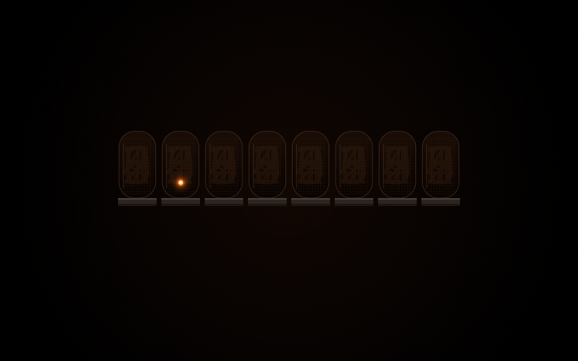
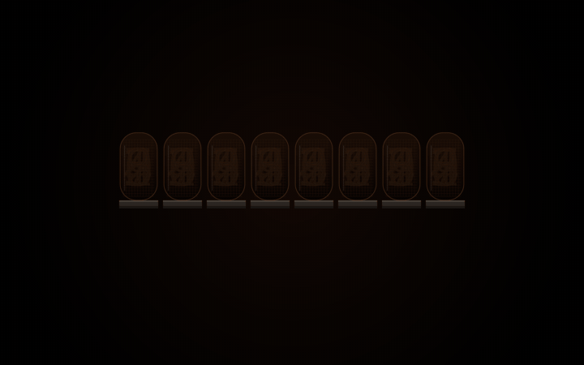

<div align="center">


# Divergence Meter

**A Steins;Gate–inspired Plymouth boot splash.**
Eight Nixie tubes flicker through possible worldlines and lock onto **1.048596** when you boot,
then fall back to **0.571024** (the α worldline) when you shut down.

*El Psy Kongroo.*


</div>

---

## Preview

| Boot · Steins;Gate worldline | Shutdown / reboot · α worldline |
| :---: | :---: |
|  |  |
| `1.048596` · *EL PSY KONGROO* | `0.571024` · *α WORLDLINE* |

> The previews are rendered from the real theme assets with the same frame logic as the
> Plymouth script (`tools/make-preview.sh`). Your splash looks exactly like this.

## Features

- **Two worldlines**: boot settles on `1.048596`, shutdown and reboot on `0.571024`.
- **Real Nixie look**: amber-tinted glass, anode mesh, dim unlit cathodes behind each digit,
  layered orange glow on the lit filament.
- **Built for fast boots**: on boot the meter is fully locked and the tagline visible in **~1 s**,
  so you see the whole thing even when Plymouth is only on screen for a few seconds.
- **Never slows your boot**: it's purely visual; Plymouth hands over to your display manager as usual.
- **HiDPI-ready**: drawn for 2880×1800 and scaled to whatever resolution Plymouth runs at.
- **Tiny**: the whole theme is ~340 KB, so your initramfs barely grows.
- **Reproducible**: every image is generated from a script (`tools/make-assets.sh`). Change the colours,
  digits or taglines and rebuild.

## Requirements

- [Plymouth](https://gitlab.freedesktop.org/plymouth/plymouth) with the **script** module
  (Arch: `plymouth`, Fedora: `plymouth-plugin-script`, Debian/Ubuntu: `plymouth` + `plymouth-themes`)
- Plymouth enabled in your initramfs and `splash` on your kernel command line
  (see [Enabling Plymouth](#enabling-plymouth) if you've never used it)

To rebuild the assets or previews you also need **ImageMagick 7**, **ffmpeg** and the **DejaVu** fonts.

## Installation

### Quick install

```bash
git clone https://github.com/<you>/plymouth-theme-divergence-meter.git
cd plymouth-theme-divergence-meter
sudo ./install.sh
```

`install.sh` copies the theme to `/usr/share/plymouth/themes/divergence-meter`, sets it as the
default and rebuilds your initramfs. Pass `--no-rebuild` to skip the rebuild.

Then **reboot**. You'll see the α worldline on the way down and the Steins;Gate worldline on the way up.

### Manual install

<details>
<summary><b>Arch Linux / Manjaro / EndeavourOS</b></summary>

```bash
sudo cp -r divergence-meter /usr/share/plymouth/themes/
sudo plymouth-set-default-theme -R divergence-meter   # -R rebuilds the initramfs (mkinitcpio -P)
```
</details>

<details>
<summary><b>Fedora / RHEL</b></summary>

```bash
sudo dnf install plymouth-plugin-script
sudo cp -r divergence-meter /usr/share/plymouth/themes/
sudo plymouth-set-default-theme -R divergence-meter   # -R runs dracut -f
```
</details>

<details>
<summary><b>Debian / Ubuntu / Pop!_OS / Mint / Zorin</b></summary>

```bash
sudo apt install plymouth plymouth-themes
sudo cp -r divergence-meter /usr/share/plymouth/themes/
sudo update-alternatives --install /usr/share/plymouth/themes/default.plymouth default.plymouth \
     /usr/share/plymouth/themes/divergence-meter/divergence-meter.plymouth 100
sudo update-alternatives --set default.plymouth \
     /usr/share/plymouth/themes/divergence-meter/divergence-meter.plymouth
sudo update-initramfs -u
```
</details>

Check which theme is active with:

```bash
plymouth-set-default-theme          # prints the current theme
plymouth-set-default-theme --list   # all installed themes
```

## Enabling Plymouth

Skip this if you already see a boot splash.

1. **Initramfs hook** (Arch, mkinitcpio): add `plymouth` to `HOOKS` in `/etc/mkinitcpio.conf`, after `udev` and before `encrypt`/`filesystems`:
   ```
   HOOKS=(base udev plymouth autodetect microcode modconf kms keyboard keymap consolefont block filesystems fsck)
   ```
   (dracut and initramfs-tools include Plymouth automatically once it's installed.)
2. **Kernel parameters**: add `quiet splash` (optionally `loglevel=3 rd.udev.log_level=3 systemd.show_status=auto vt.global_cursor_default=0` for a log-free boot):
   - **GRUB**: edit `GRUB_CMDLINE_LINUX_DEFAULT` in `/etc/default/grub`, then `sudo grub-mkconfig -o /boot/grub/grub.cfg`
   - **systemd-boot**: append to the `options` line in `/boot/loader/entries/*.conf`
   - **UKI** (unified kernel image): append to `/etc/kernel/cmdline`, then rebuild (`sudo mkinitcpio -P`)
3. Rebuild the initramfs and reboot.

## Testing

### Safe preview (recommended)

```bash
tools/make-preview.sh            # writes preview/boot.gif and preview/shutdown.gif
mpv build/preview-boot.mp4       # or open the GIFs in any image viewer
```

This renders the animation from the theme's own images and timing, **without touching Plymouth or your display**.

### Live test (from a text console only)

Plymouth takes over the whole display. **Do not run this inside your graphical session** (Wayland/X11):
you'll get a black screen. Switch to a TTY first (`Ctrl+Alt+F3`), log in, then:

```bash
sudo plymouthd --debug --tty=$(tty)
sudo plymouth --show-splash
sleep 8
sudo plymouth --quit
```

Switch back to your desktop with `Ctrl+Alt+F1` (or F2, depending on your display manager).
To test the shutdown look, run `sudo plymouthd --mode=shutdown ...` instead.

## Customization

Everything lives in two places: the **script** (behaviour) and **`tools/make-assets.sh`** (look).

### Timing

At the top of `divergence-meter/divergence-meter.script`, per mode, in frames (the refresh runs at **50 fps**):

| Variable | Boot | Shutdown | Meaning |
| --- | :---: | :---: | --- |
| `DARK` | `0` | `5` | frames of unlit tubes before the flicker starts |
| `LOCK_START` | `20` | `35` | frame where the first tube locks |
| `LOCK_STEP` | `4` | `5` | frames between each tube locking |
| `TAG_START` | `36` | `70` | frame where the tagline starts fading in |
| `TAG_FADE` | `12` | `10` | length of the tagline fade |
| `FLICKER` | `2` | `2` | new random digit every N frames |

If your boot is slower and you want a longer show, raise `LOCK_START`/`LOCK_STEP`.
If you keep the preview tool in sync, update `TIMINGS` in `tools/make-preview.sh` too.

### Worldline numbers

Set `target[0]` and `target[2]` … `target[7]` (tube 1 is always the decimal point):

```c
# 1.130426: the β worldline
target[0] = 1; target[2] = 1; target[3] = 3; target[4] = 0; target[5] = 4; target[6] = 2; target[7] = 6;
```

### Colours, taglines, size

```bash
GLOW='#00aaff' MID='#55ccff' CORE='#e8f8ff' TAG='#7fc8ff' tools/make-assets.sh divergence-meter
```

Edit the tagline text near the end of `tools/make-assets.sh`. Tube size is `W`/`H`/`PT` in the same file
and the layout in the script follows it (`TW`, `TH`, `GAP`).

After any change: `sudo ./install.sh` (it re-copies the files and rebuilds the initramfs).

## Uninstall

```bash
sudo ./uninstall.sh            # switches back to bgrt (or spinner) and removes the theme
sudo ./uninstall.sh spinner    # or pick the theme to switch to
```

## Troubleshooting

<details>
<summary><b>Black screen instead of the meter</b></summary>

The script failed to load. Boot still continues normally. Check:

```bash
plymouth-set-default-theme                          # is divergence-meter active?
ls /usr/share/plymouth/themes/divergence-meter      # are all files there?
journalctl -b | grep -i plymouth
```

For a full log, boot once with `plymouth.debug` on the kernel command line and read `/var/log/plymouth-debug.log`.
</details>

<details>
<summary><b>I still see boot messages / no splash at all</b></summary>

`splash` is missing from the kernel command line, or Plymouth isn't in the initramfs. See [Enabling Plymouth](#enabling-plymouth).
Check with `cat /proc/cmdline`. With a UKI, `/etc/default/grub` is **not** used; edit `/etc/kernel/cmdline`.
</details>

<details>
<summary><b>I never see the final number</b></summary>

Your boot is faster than the animation. Lower `LOCK_START`, `LOCK_STEP` and `TAG_START` (see [Timing](#timing)).
The defaults lock the meter in ~1 s on boot.
</details>

<details>
<summary><b>Changes don't show up</b></summary>

The theme is copied **into the initramfs**. Re-run `sudo ./install.sh` (or `plymouth-set-default-theme -R divergence-meter`)
after every change.
</details>

## Project structure

```
divergence-meter/            the theme itself (this is what gets installed)
├── divergence-meter.plymouth  theme descriptor
├── divergence-meter.script    animation logic (Plymouth script language)
├── tube.png                   glass, mesh and unlit cathodes
├── d0.png … d9.png, dot.png   lit digits with glow
├── tagline-boot.png           EL PSY KONGROO
├── tagline-shutdown.png       α WORLDLINE
└── bg.png                     background gradient
tools/
├── make-assets.sh           regenerates every PNG
├── make-preview.sh          renders preview GIFs/MP4s without Plymouth
└── make-banner.sh           renders the README banner
preview/                     README media
install.sh / uninstall.sh
.claude/skills/              instructions for AI coding agents working on this repo
```

## For AI agents

This repo ships a [Claude Code skill](.claude/skills/divergence-meter/SKILL.md) describing the
architecture, the safe subset of the Plymouth script language, how to change timings, numbers and colours,
and how to verify changes **without** running Plymouth on a live session.

## Credits

- Inspired by the divergence meter from **Steins;Gate** (© MAGES. / Nitroplus / 5pb.). This is an unofficial
  fan project; no official artwork is used. Every image is drawn from scratch by `tools/make-assets.sh`.
- Digits and text use the [DejaVu](https://dejavu-fonts.github.io/) fonts (Bitstream Vera license).
- README layout inspired by [adi1090x/plymouth-themes](https://github.com/adi1090x/plymouth-themes) and
  [catppuccin/plymouth](https://github.com/catppuccin/plymouth).

## License

[MIT](LICENSE) © 2026 Darryl Mathias
